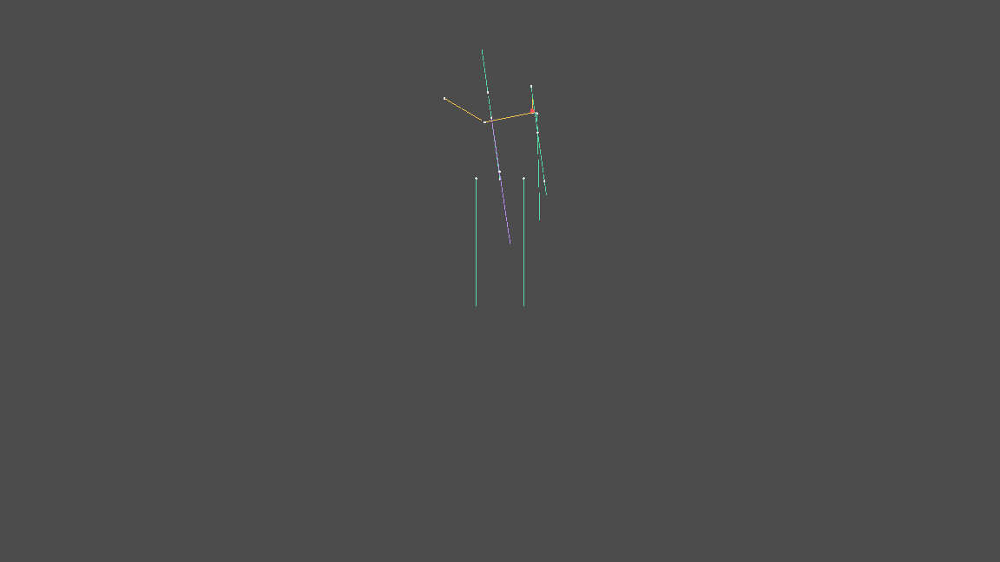

# Running RigKit on a real skeleton (烬塔 ranger)

First run of RigKit against authored bone geometry instead of the stick-figure
demo. Skeleton: `烬塔/client/assets/actors/chars_ranger/ranger.json`
(Spine 4.3, 16 bones, shoulders 120 px, cloak 150 + 200 px), rebuilt as Godot
`Skeleton2D` + `Bone2D` in `烬塔/spike/rigkit-real/`.



Yellow = the three bone arm driven by `TwoBoneAim`, purple = cloak driven by
`PhysicsConstraint`, red dot = the aim target, green = the rest of the skeleton.

## What ran

| Bone chain | Lengths | Constraint | Measured |
|---|---|---|---|
| `arm_ul` -> `arm_fl` -> `hand_l` | 120 / 140 / 40 px | `TwoBoneAim` at a moving target | bind ok, reach 260 px, hand error ≤ 37.7 px over 240 frames at 60 fps |
| `cloak_root` (+ `cloak_tip`) | 150 / 200 px | `PhysicsConstraint`, rotation only | rotation offset oscillates ±9.9° behind a ±0.22 rad torso sway |

The error is the aim's smoothing lag against a target moving at 60 px amplitude
~1.1 rad/s, not a solver shortfall: with a static target the hand lands on it.

## What could not run, and why

**Foot lock does not bind on 烬塔's skeletons.** Every character
(`player_rigby`, `chars_ranger`, `chars_ritual`) has one leg bone:
`leg_l` / `leg_r`, 350-400 px, no knee, no ankle. `TwoBoneIK` needs hip -> knee ->
ankle; there is no third joint to solve. RigKit reports this instead of inventing
bones. To use foot lock, the rig needs a three bone leg (`leg` -> `shin` -> `foot`),
which is an asset change, not a library change.

**Rigby2D exposes no bone write API.** 烬塔's actual runtime is
`RigbySkeleton2D` from `client/addons/rigby2d/`. Its exported GDExtension surface
(dug out of `librigby_godot.dylib`) is:

```
set_skeleton_file / set_atlas_file / set_animation / set_looping / loop / mix
track / queue / delay / clear_track / set_track_alpha / set_track_time_scale
get_current_animation / advance / seconds / get_animation_names
get_animation_duration / get_skin_names / get_bone_names / get_event_names
get_bone_transform / get_bone_position / reset_physics / get_load_error
```

Only getters. RigKit writes poses, so driving Rigby2D would need
`set_bone_transform` / `set_bone_rotation` added on the Rust side. Until then RigKit
can only *observe* that runtime.

**spine-godot in `spike/spine-poc` is not usable on Godot 4.7.2.** The extension
loads, but `SpineSprite.get_skeleton()` returns null (and the dummy/headless
renderer path throws `texture_2d_get: Parameter "t" is null`). The bundled
binaries are built for an older ABI. That is why this validation used Godot's
native `Bone2D`, which is the runtime 烬塔 clients can switch to without a new
dependency.

## Adapter finding: degrees vs radians

Spine runtimes report bone rotations in **degrees**; RigKit works in **radians**.
`SpineBoneSource` was passing the raw value through, which would have bent bones
the wrong way on first contact with a real runtime. Fixed:
`rotation_is_degrees` now converts every auto-detected accessor (including the
parent chain and the write-back), defaults to `true`, and callables supplied
through `api` are documented as the caller's own contract. Covered by
`_test_spine_adapter_degrees_to_radians` and `_test_spine_adapter_parent_chain`.

## Reproduction

```bash
cd "烬塔/spike/rigkit-real"
godot --headless --path . --quit-after 400          # numbers
godot --path . --windowed --quit-after 400          # + /tmp/jinta_rigkit_real.png
```

Bone2D notes hit while building this, both now handled in `spine_json_rig.gd`:
`set_autocalc_length_and_rest` does not exist on Godot 4.7 (it is
`set_autocalculate_length_and_angle`), and a zero length bone makes `Skeleton2D`
report `det == 0` once per bone until `set_rest` is stored.
