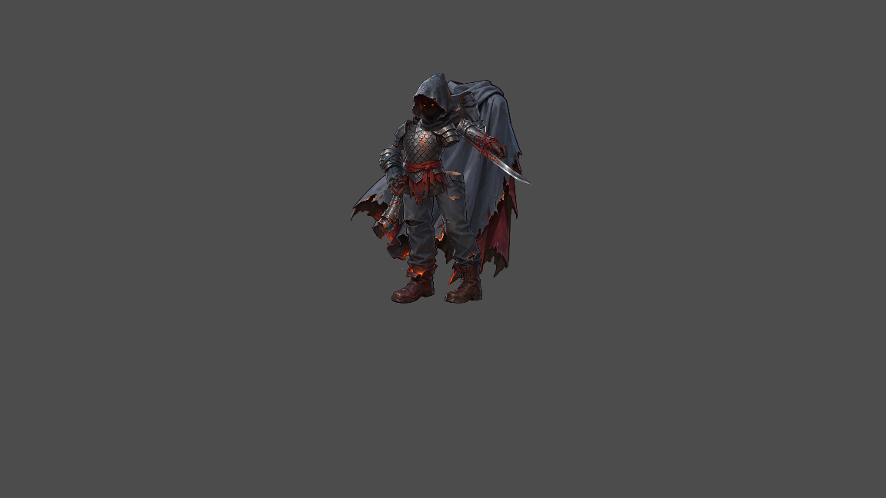

# Driving Rigby2D: the two-bone-write patch

Rigby2D's Godot runtime (`jaisurya-dev-art/rigby2d`, MIT OR Apache-2.0) ships
`RigbySkeleton2D`, which **reads** pose but never **writes** it. The stock surface is
read-only:

```
set_skeleton_file / set_atlas_file / set_animation / set_looping / playing / speed / skin
loop / mix / track / queue / delay / clear_track / set_track_alpha / set_track_time_scale
get_current_animation / get_current_time / advance / seconds
get_animation_names / get_animation_duration / get_skin_names / get_bone_names
get_event_names / get_bone_transform / get_bone_position / reset_physics / get_load_error
```

No IK, no constraints, no bone setter. That is a runtime gap, not something a GDScript
layer can fix: the pose lives in Rust, and only Rust can re-solve and re-submit it.

`docs/patches/rigby2d-bone-write.patch` adds the two accessors every pose-driving
library needs. It touches one file and adds 33 lines.

## What it adds

| Function | Meaning |
|---|---|
| `get_bone_world_rotation(bone) -> float` | Bone world rotation in **radians, Godot axes** (Y down, clockwise positive). `-m.b.atan2(m.a)`, i.e. the Spine Y-up counter-clockwise matrix flipped. |
| `set_bone_local_rotation(bone, radians) -> bool` | Writes a **local** rotation (radians, Godot axes), then `update_world` and rebuilds the render batches, so the result is visible in the same frame. Returns `false` on an unknown bone. |

Local, not world: Rigby2D already re-solves the hierarchy in `update_world`, so a caller
that knows the parent rotation (as `BoneSource` does) can express everything in local
space and keep the runtime as the single owner of the world pass. Writing world directly
would need an inverse-parent solve inside the runtime for no gain.

## Build

The Rust core (`rigby-runtime`) already implements Spine's whole constraint set —
`Step::{Ik, Transform, Path, Slider, Physics}` in `pose.rs::update_world`, including
`solve_physics`. So nothing needs to be added downstream: expose the setter and the
runtime's own IK/physics can be mixed with RigKit's.

```bash
git clone --depth 1 https://github.com/jaisurya-dev-art/rigby2d.git
cd rigby2d
git apply /path/to/docs/patches/rigby2d-bone-write.patch
cd runtimes/rust && cargo build --release -p rigby-godot     # 1m53s on an M-series Mac
# artifact: runtimes/rust/target/release/librigby_godot.dylib
```

The crate pins `godot = 0.5.5` with `api-4-3`, so the library loads in Godot 4.3 **and
every later version** — it loads fine in 4.7.

## Wiring it into a project

1. Copy the built `librigby_godot.dylib` over `addons/rigby2d/bin/` (back the original
   up first — this is a shipping binary).
2. **Android is a separate build.** `librigby_godot.android.arm64.so` has to be rebuilt
   from the same patched source; a macOS dylib does not help the phone build.
3. `RigbyBoneSource.probe(node)` reports whether the runtime in front of it has the
   setter, so a mismatch fails loudly instead of silently doing nothing.

## Verified

`烬塔/spike/rigby-rigkit` — the patched runtime, the real `player_rigby` skeleton
(15 bones: `arm_ur 100 / arm_fr 90 / hand_r 40`, `torso -> cloak_root 140 -> cloak_tip 200`),
RigKit `TwoBoneAim` on the arm and `PhysicsConstraint` on the cloak, 240 frames at 60 Hz:

```
[rigby-rigkit] load_error='' writable=true
[rigby-rigkit] bones(15)=["root","hip","torso","chest","head","arm_ul","arm_fl",
                          "arm_ur","arm_fr","hand_r","sword","leg_l","leg_r",
                          "cloak_root","cloak_tip"]
[rigby-rigkit] arm bind ok upper=100.0 lower=90.0 reach=190.0
[rigby-rigkit] RESULT hand_error_max=0.00 cloak_rot_max=12.4deg cloak_offset=8.6px
[rigby-rigkit] PASS
```

Hand error **0.00 px** on a moving target — the aim lands exactly on the target every
frame, on the runtime 烬塔 actually ships. The cloak lags 12.4° / 8.6 px behind a ±0.22 rad
torso sway.



## Two contract notes

- **The animation system must write the pose every frame.** Rigby2D applies its clip in
  `advance(seconds)`; constraints must run *after* it in the same frame, otherwise they
  read their own output and the inertia term cancels itself (measured: cloak offset froze
  at 0.011 px until the torso was re-authored per frame).
- **`dir_offset` is always 0 for Spine-shaped runtimes.** Spine bones point along their
  local +X and children are placed by explicit translation, so a child sitting at
  `(70, 120)` says nothing about the bone axis. `SpineBoneSource`'s "first child angle"
  heuristic (fine for a `Node2D` hedge) would invent a 54° offset here; `RigbyBoneSource`
  therefore returns 0 unconditionally, and the regression test locks that in.

## Licence

The patch is a derivative of Rigby2D, which is dual-licensed **MIT OR Apache-2.0**; this
repository is MIT, which is compatible. The patch contains no Spine runtime code — it
calls Rigby2D's own pose pass. RigKit itself remains independent of both.
